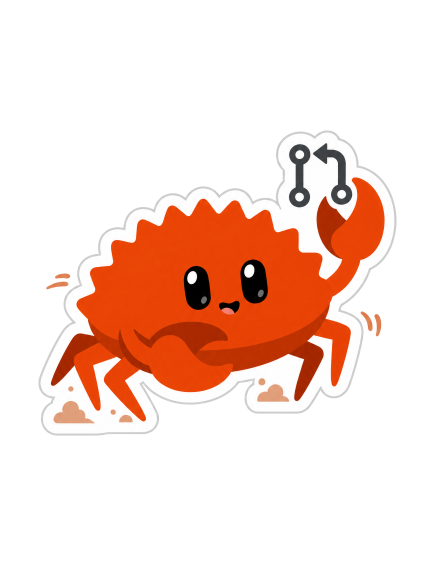
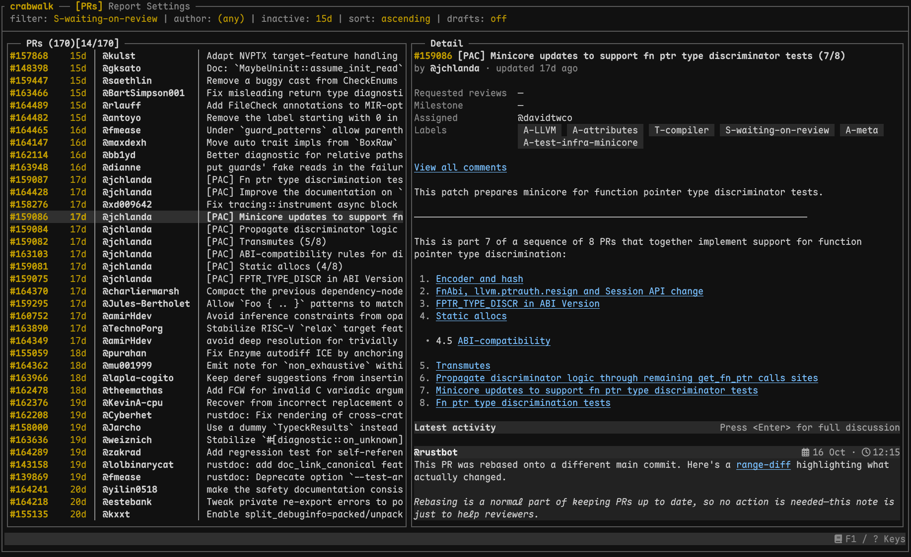
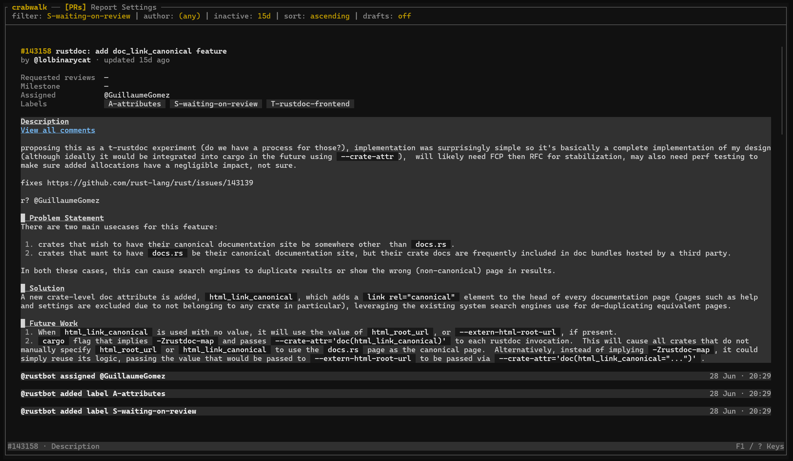
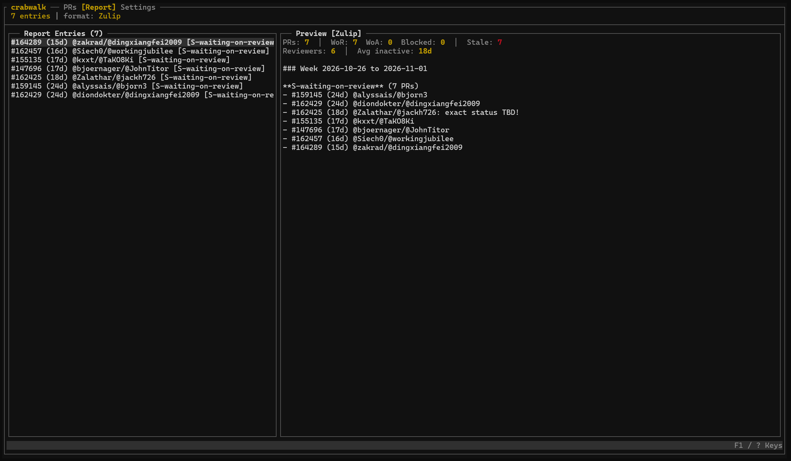

### crabwalk

A terminal app for triaging pull requests in `rust-lang/rust`.

crabwalk helps you find PRs that have gone quiet, catch up on the discussion, and put together a report for Zulip. It follows the [Rust release team's triage procedure](https://forge.rust-lang.org/release/triage-procedure.html), keeping the information you need in one place.

<br clear="left">

## Installation

Requires Rust 1.98 or newer.

```bash
cargo install --git https://github.com/shard77/triage-tui
```

## Usage

Run `crabwalk` in your terminal.

## Features

- **PR filters and sorting.** Filter by label, author, and a minimum number of inactive days, or turn the inactivity filter off. Sort by inactivity in either direction and choose whether to include drafts.
- **Quick filters.** Start with presets for PRs waiting on review, waiting on the author, or blocked. Save, edit, and delete your own presets, and choose a default filter for startup.
- **PR details.** See descriptions, labels, assignees, requested reviewers, milestones, and recent activity alongside the PR list or in a full-screen view. Refresh the list or open a PR in your browser.
- **Conversations and reviews.** Read comments, review summaries, inline review threads with their diff hunks, and timeline events. Expand or collapse discussions, including resolved, outdated, and hidden comments.
- **Markdown reader.** Read formatted Markdown with syntax-highlighted code, expand code blocks, and follow links. Search within the selected section, jump between matches, select characters or lines, and copy text to the clipboard.
- **Triage reports.** Collect PRs, add or edit notes, and remove entries as you work. See summary counts and inactivity statistics, then copy a weekly report as Zulip Markdown or plain text, grouped by status label and sorted by inactivity.

## License

crabwalk is licensed under the [GNU General Public License v3.0](LICENSE).

## Contributors

Contributions are welcome. Before submitting a pull request:

- Open an issue or start a discussion about the proposed change first, and link it in your PR.
- Keep PRs small and focused on one change.
- Have a human review any LLM-generated contribution before submitting it. You are responsible for understanding and checking everything you submit.

Thanks to everyone who contributes code, documentation, bug reports, and ideas. See the [contributors](https://github.com/shard77/triage-tui/graphs/contributors).

## Screenshots

### Pull request list



### Pull request details



### Triage report


